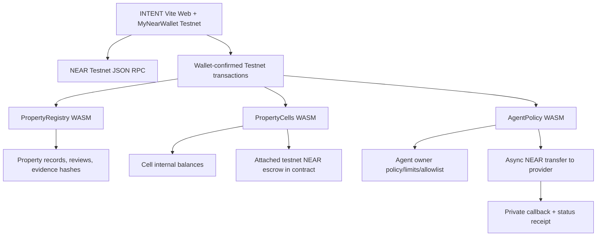

# Architecture, threat model, and evidence boundaries

## Runtime graph

These are **three distinct native contracts**, not an EVM wrapper. Deployed on different `.testnet` accounts. No cross-chain bridge, no SKALE gas/token approvals. Static site assets are delivered offchain and are not a trusted source for reviewed records.

## Trust and authorization

### PropertyRegistry

- Contract `owner` creates a property ID with SHA-256 metadata digest.
- Owner can grant/revoke reviewer/evidence-writer account roles.
- Reviewer or owner records `approved=true|false` and SHA-256 note hash; reviewer **does not** verify actual title autonomously.
- Owner/reviewer/delegated agent can append evidence hash; historical entry cannot be edited using exposed methods.
- **Open risk:** registry and settlement are independent. A registry `PENDING`/`REJECTED` record can still have a Cell listing configured by the settlement owner. Operational approval is mandatory for demo; production must enforce cross-contract approval or verified oracle data.

### PropertyCells

- Owner chooses `price_yocto` and `total_cells` (1..1,000,000); contract enforces cap on sold cells.
- Buyer calls payable `buy_cells` with attached native Testnet NEAR exactly `price * quantity`. Ledger credits buyer account; no token is minted under NEP-141/NEP-171.
- Cell balances can be moved with `transfer_cells`, without enforcement of legal/investor eligibility. **Do not treat as property ownership.**
- Purchase proceeds remain in the contract, not immediately sent to an issuer. Owner can withdraw to configured treasury, retaining a storage/gas reserve. This custody/recovery model must be reviewed before any real-value use.
- **Open risk:** BTreeMap + synchronous serialization and no paid storage deposits, so an unaudited contract should not be exposed to arbitrary network scale or real funds.

### AgentPolicy

- Contract owner configures agent account, SHA-256 policy hash, per-action cap, UTC-day budget and provider allowlist.
- Agent account must call `execute_payment` and attach exact testnet NEAR, which is forwarded with a NEAR Promise; a private callback finalizes PENDING → COMPLETED/FAILED. On provider-transfer failure, the callback attempts refund and budget rollback.
- **No autonomous offchain AI runtime is shipped.** A separate application/signing infrastructure would be required for a real agent. Policy hash means an externally supplied policy digest, not independent policy understanding.
- Emergency freeze rejects *new* payments, not payments already queued in asynchronous NEAR execution.
- **Open risk:** refund and budget rollback depend on callback execution; cross-receipt edge cases (e.g. delayed callback on a previous UTC day) and contract funding need further production testing. `get_recent_receipts` is public; do not place sensitive customer data in action hashes, property IDs, provider account names or logs.

## Technical readiness / known limits

- JS/static data checks included; see `npm run check`.
- Rust crates are sources awaiting **real cargo compilation**, which was unavailable during preparation in this environment. The code has NOT been executed on NEAR Testnet as delivered, and the UI has not been validated end-to-end against a live wallet here.
- Production requires threat modeling, audited storage accounting, secure contract upgrades/governance, bounded state size, race/replay testing, verified agent key custody and offchain evidence provenance.
- SHA-256 digest of a document only proves a supplied byte string matches a hash. It does not prove the document is accurate, licensed or valid.
- There are no mainnet assets and no real-estate deeds, yield distributions, swaps, NEAR Intents, NEP token standard, EVM interoperability or legal investor compliance.

## Site integrity guarantee

The existing INTENT visual identity and blue/dark/light CSS survive; original `partners-data.js` and `skale-partners.js` filenames were retained because they hold the 117-entry directory/D3 implementation. They **do not sign or submit SKALE transactions** in this new frontend. The source catalogue contains 50 properties; only 8 are seeded as illustrative onchain listings. All organization records are treated as prospective directory entries, not verified partnerships.

## What to tell reviewers

> “This is a native-NEAR infrastructure demo. Identity, title and cashflows are out of scope; what is genuinely onchain is a registry of evidence hashes, user-signed testnet Cell ledger transfers, and policy-constrained NEAR agent payments. The provenance of prior EVM work is disclosed.”
